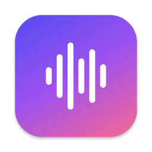
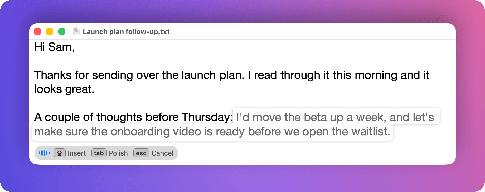

<p align="center">
  
</p>

<h1 align="center">Hushhh</h1>

<p align="center">
  <strong>Press Caps Lock, speak, and your words appear as grey ghost text at the cursor, in any Mac app.</strong><br>
  Caps Lock inserts them, Tab polishes them, Esc cancels. Speech recognition runs on your Mac.
</p>

<p align="center">
  <a href="https://github.com/graiz/hushhh/releases/latest"></a>
</p>

<p align="center">
  
  
  <a href="LICENSE"></a>
  <a href="#build-from-source"></a>
</p>

<p align="center">
  
</p>

> [!NOTE]
> While Hushhh is running, **Caps Lock is used for dictation** instead of capitals. Quitting Hushhh gives it back.

## Install

Download the DMG from the [latest release](https://github.com/graiz/hushhh/releases/latest), open it, and drag Hushhh to Applications. It's signed and notarized by Apple. On first launch, Hushhh asks for Microphone and Accessibility access (see [Permissions](#permissions)).

## How to use it

1. Click into any text field: an email, a document, a chat, or a terminal.
2. Press **Caps Lock** and talk. Your words appear as you speak, in the document's own font, right after the cursor.
3. Press **Caps Lock** again to insert them, **Tab** to tidy them up with a language model first (optional), or **Esc** to cancel.

Hushhh lives in the menu bar. It works in native apps, browsers, Google Docs, Excel, Electron apps and terminals; where an app doesn't reveal its cursor, the text appears in a small bubble instead.

## Permissions

| Permission | Why |
| --- | --- |
| Microphone | To hear you while you dictate |
| Accessibility | To detect Caps Lock, find the text cursor, and insert text |

Hushhh remaps Caps Lock to F18 with `hidutil` while it runs and restores your mapping when it quits. If it's ever force-quit and Caps Lock stops working, reopen Hushhh or run `hidutil property --set '{"UserKeyMapping":[]}'`.

## Speech engines

Both run on your Mac. Pick one in Settings › Models.

| Engine | Size | Languages | Best for |
| --- | --- | --- | --- |
| **QVAC TranscribePsy** (default) | 305 MB | English, Spanish, French, German, Italian, Portuguese, Dutch, Polish | Speed and accuracy, with punctuation |
| **Whisper** ([WhisperKit](https://github.com/argmaxinc/WhisperKit)) | 75–632 MB | Up to 99 | Other languages |

## Privacy

- Your audio is processed on your Mac and never saved or sent anywhere.
- Polish is off by default. If you turn it on, only the dictated text is sent, to the provider you choose (Claude Code, OpenAI, OpenRouter, or a local server).
- No telemetry or analytics. Full details are in [PRIVACY.md](PRIVACY.md).

## Build from source

Requirements: Apple silicon, macOS 14+, Xcode 26, and `brew install cmake xcodegen`.

```bash
git clone https://github.com/graiz/hushhh.git && cd hushhh
xcodegen generate
open Hushhh.xcodeproj        # ⌘R
```

The first build fetches the QVAC engine at a pinned commit and compiles it (about a minute). Signing, the project layout, and the developer diagnostics are covered in [docs/DEVELOPMENT.md](docs/DEVELOPMENT.md).

## Credits

Inspired by Wispr Flow, [Handy](https://github.com/cjpais/Handy) and [Cotypist](https://cotypist.app). Built on [QVAC TranscribePsy](https://github.com/tether-ai-research/qvac-transcribepsy), [ggml](https://github.com/ggml-org/ggml) and [WhisperKit](https://github.com/argmaxinc/WhisperKit).

## License

MIT; see [LICENSE](LICENSE). Third-party components and model licences are listed in [THIRD_PARTY_NOTICES.md](THIRD_PARTY_NOTICES.md).
